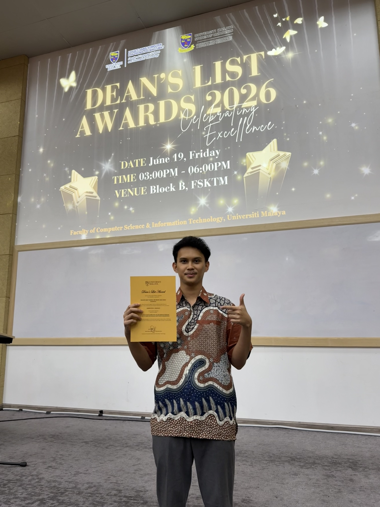

# Introduction
Hi! I'm Shahir Izzat Danial Bin Mohd Aziz Shah, a student in the Software Maintenance
and Evolution course.
I expect to learn a lot about modern software maintenance
practices and how to work with legacy systems.

- **Fun fact**: I like watching the sunset and enjoy listening to Indonesian indie songs.
- **Course expectations**: To gain practical skills in software maintenance that will help me grow in my career.

